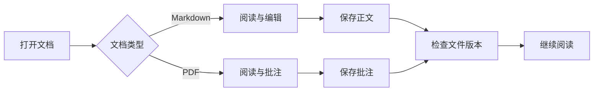

# 欢迎使用 StuartMD

**当前版本：3.5.11**

StuartMD 用于阅读 Markdown 与 PDF、编辑笔记、保存批注，以及结合正文和知识资料进行 AI 问答。

## 打开文档

1. 使用 **文件 → 打开文件**，或者按 `Ctrl+O` 选择 Markdown / PDF。
2. 打开 Markdown 后，使用顶部的 **阅读、分栏、源码** 切换模式。
3. 单击段落、表格或代码块进行编辑，按 `Ctrl+S` 保存。
4. 使用 **文件 → 打开文件夹** 浏览工作目录，并在伴读的知识页面建立索引。

## 编辑、保存与恢复

阅读、分栏和源码模式共享当前文档内容。使用 `Ctrl+Z` 撤销，使用 `Ctrl+Shift+Z` 或 `Ctrl+Y` 重做。切换标签时会提交正在编辑的内容，各个标签分别保留自己的编辑状态。

保存保持已经确认的文件编码和未编辑区域的换行。需要确认编码时，请查看所选编码的完整预览。文件被其他程序修改后，自动保存暂停；冲突界面提供基础内容、本地内容与外部内容，可以检查合并或保存副本。

未保存文档和空正文都会记录草稿。重新启动后，恢复界面可以查看已经持久化的修改。中断的保存操作也保留可检查的内容版本，可以将所需版本保存为独立文件。

## 图表与公式

下面的图表展示阅读与编辑的使用路径。点击图表可以编辑 Mermaid 源码，离开编辑区域后恢复图表显示。



行内公式：$E = mc^2$。

$$
\sum_{i=1}^{n} i = \frac{n(n+1)}{2}
$$

## PDF 阅读与批注

打开 PDF 后，可以使用缩放、适应高度、旋转和双页显示。选中文字后，鼠标附近会出现高光、下划线、删除线和评论工具。

新增批注自动保存在本机。点击 **写入 PDF** 后，批注会写入 PDF 文件；随后修改原生批注的颜色、评论或删除批注都会保存该文件。保存会检查外部修改，并保留恢复内容。

清除批注会要求确认，默认保留评论；需要删除评论时选择 **同时清除评论**。使用 `Ctrl+Z` 撤销批注操作，使用 `Ctrl+Shift+Z` 或 `Ctrl+Y` 重做。

## AI 问答

在设置中启用 AI，选择服务商与模型并配置 API Key。选中正文后点击 **问答**，或者按 `Alt+E`；按 `Alt+I` 打开伴读面板。

回答会逐步显示，可以复制、取消和继续追问。关闭 AI 后停止相关请求。模型需要有效的 Token 计数配置；设置、模型资源或上下文预算不满足要求时，界面显示具体原因。

API Key 使用当前 Windows 用户加密保存。请在软件设置中填写密钥。

## 知识、会话与记忆

打开工作目录后，在 **伴读 → 知识** 选择 BGE-M3 或多语言 MiniLM，点击建立索引。首次准备模型需要联网下载资源；完成后可以查询实际文件内容，打开 Markdown 段落或 PDF 来源页面，并引用到问答。

知识状态会显示文件数量、模型、来源变化和未完成的资料。部分索引需要确认后引用。扫描 PDF 的 OCR 结果会报告低置信度内容。

**会话** 页面可以查看和恢复完整历史。**记忆** 页面可以查看来源、修改、固定和删除记录。学习模式支持关闭、询问和自动保存；已经确认的偏好按文档、工作目录或全局范围参与适用的请求。

## 排版示例

*斜体*、**加粗**、~~删除线~~、`行内代码`、<u>下划线</u>。

```javascript
function greet(name) {
  return `你好，${name}！`;
}
console.log(greet("StuartMD"));
```

| 文档内容 | 操作 |
| --- | --- |
| 普通段落 | 单击后就地编辑 |
| 表格 | 编辑单元格，使用 Tab 切换 |
| 代码块 | 编辑代码正文，保留语言标记 |
| 公式与图表 | 编辑对应源码 |

- [x] 打开欢迎文档
- [ ] 切换阅读、分栏和源码模式
- [ ] 保存一份自己的 Markdown 笔记
- [ ] 打开 PDF 并创建批注
- [ ] 配置 DeepSeek 并进行正文问答

## 常用快捷键

| 快捷键 | 操作 |
| --- | --- |
| `Ctrl+O` / `Ctrl+N` | 打开文件 / 新建文档 |
| `Ctrl+S` / `Ctrl+Shift+S` | 保存 / 另存为 |
| `Ctrl+1` / `Ctrl+2` / `Ctrl+3` | 阅读 / 分栏 / 源码 |
| `Ctrl+Z` | 撤销 |
| `Ctrl+Shift+Z` / `Ctrl+Y` | 重做 |
| `Ctrl+F` | 查找 |
| `Alt+E` / `Alt+I` | 选区问答 / 伴读面板 |

外观设置提供浅色、灰色、深色、羊皮纸、小黄人和壁纸主题。插件存放在 `%APPDATA%\StuartMD\plugins\`，首次启用需要确认授权。

项目与反馈：[StuartMD](https://github.com/ghostLLC/StuartMD)、[GitHub Issues](https://github.com/ghostLLC/StuartMD/issues)。
