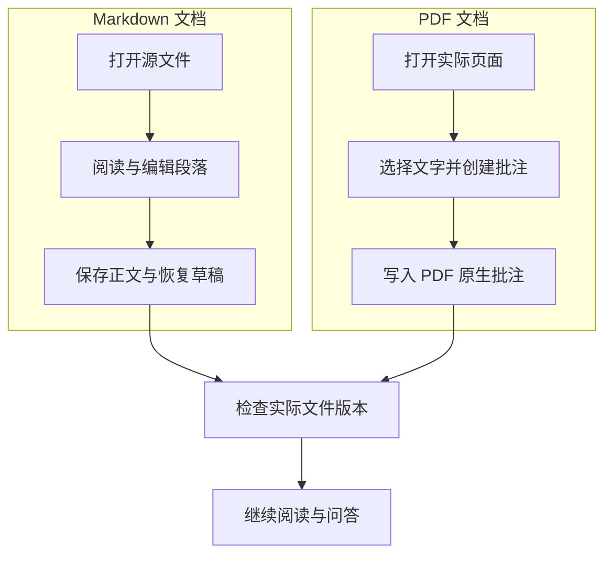
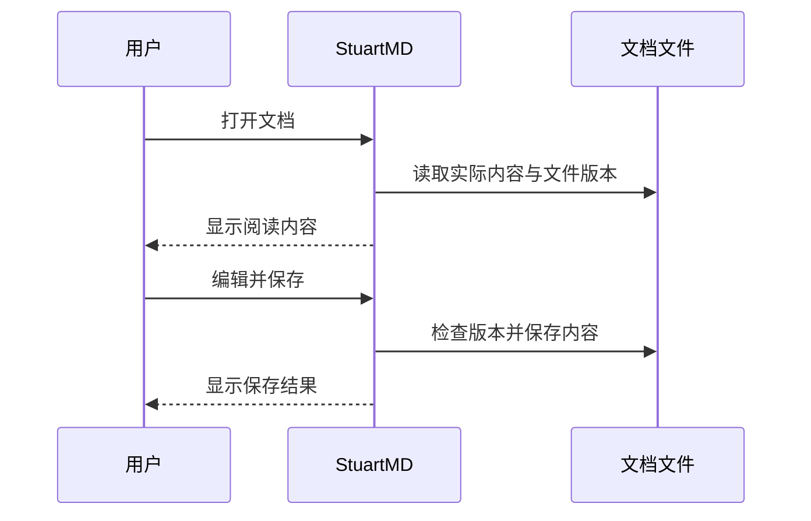

# 示例文档

**当前版本：3.5.17**

本文包含段落、表格、列表、代码、公式和 Mermaid 图表，用于体验 StuartMD 的阅读与编辑。

## 阅读与编辑

使用顶部的阅读、分栏和源码切换模式。单击段落、表格或代码块可以编辑；选中正文后使用浮动工具栏。保存保持已经确认的文件编码与未编辑区域的换行。

使用 `Ctrl+Z` 撤销，使用 `Ctrl+Shift+Z` 或 `Ctrl+Y` 重做。文件出现外部修改后，可以在冲突界面检查内容并保存副本。未保存文档和空正文均可记录持久化草稿，重启后使用恢复界面继续编辑。

## 文本样式

*斜体*、**加粗**、~~删除线~~、`行内代码`、<u>下划线</u>。

这段中文正文可以用于检查段落编辑、选区操作和自动保存。修改其中一个词语后，可以切换到源码模式检查完整 Markdown，再使用撤销与重做观察原文变化。

StuartMD displays Markdown, tables, code, mathematics and diagrams. Split mode places the document preview on the left and the source on the right. 😀

## 列表

- 文档阅读
- 文档编辑
  - 段落内容
  - 表格内容
- PDF 批注

1. 打开文档。
2. 编辑内容。
3. 保存文件。

## 任务列表

- [x] 打开示例文档
- [ ] 修改一个段落并保存副本
- [ ] 撤销修改并执行重做
- [ ] 使用 PDF 创建批注

## 表格

| 功能 | 使用方式 |
| --- | --- |
| 打开文件 | 文件菜单或者 `Ctrl+O` |
| 保存文件 | `Ctrl+S` |
| 另存为 | `Ctrl+Shift+S` |
| 选区问答 | 配置 AI 后选中文字，按 `Alt+E` |
| 知识资料 | 打开工作目录，在伴读知识页面建立索引 |

## 代码块

```javascript
function greet(name) {
  return `你好，${name}！`;
}

const features = ["read", "edit", "save", "restore", "pdf"];
console.log(greet("StuartMD"));
features.forEach(feature => console.log(feature));
```

```python
def greet(name: str) -> str:
    return f"你好，{name}！"


print(greet("StuartMD"))
```

## LaTeX 公式

行内公式：$E = mc^2$，以及 $a^2 + b^2 = c^2$。

$$
\sum_{i=1}^{n} i = \frac{n(n+1)}{2}
$$

$$
\int_0^1 x^2\,dx = \frac{1}{3}
$$

## Mermaid 流程图



## Mermaid 序列图



## 引用

> 文档内容保持清晰，编辑结果能够保存，来源和修改能够检查。
>
> 这段多行引用可以用于测试选区操作。

## PDF

打开 PDF 后可以缩放、旋转和双页阅读。选区工具栏支持高光、下划线、删除线与评论。新增批注首先保存在本机；点击写入 PDF 后生成原生批注。修改原生批注会保存实际文件，外部修改引发的冲突会保留恢复内容。

清除操作默认保留评论，可以选择同时清除评论。撤销和重做支持当前文档最近 20 次批注操作。

## AI 与知识资料

在设置的 **已保存模型 → 添加模型** 中选择服务商、必要区域，填写 API Key 并勾选多个模型。同一连接共用密钥；预置型号已经提供地址、思考能力与容量。顶部与伴读输入区从已保存列表直接切换，当前选择、默认模型及最近使用会持久保存。

点击模型的 **验证回答** 会发送公开测试消息并核验计数、流式正文、完成标记与用量；连接的 **获取模型目录** 显示来源及获取时间。修改密钥或模型参数后需要重新验证。**添加其他型号** 支持目录外型号、输出预算、容量及请求参数；自定义服务支持新建独立连接或复用已有连接。思考方式中的 **服务默认** 使用服务端默认参数。

选中 Markdown 或 PDF 正文后按 `Alt+E`，在回答面板继续追问或取消请求。按 `Alt+I` 打开伴读面板。切换模型用于后续请求，已经发送的请求保留原模型配置。

打开工作目录后，在知识页面建立索引。软件自动使用 BGE-M3 进行语义检索。结果包含原文和来源，可以打开 Markdown 段落或 PDF 页面并引用到问答。部分索引和低置信度 OCR 资料会显示具体状态。

问答页面可以选择选中内容、当前章节、整篇文档和工作区资料，并查看本次实际材料。快速问答与伴读面板共享答案和草稿，停止或失败的回答保留实际状态。完整答案可以复制或保存 Markdown 笔记。

会话页面支持搜索、筛选、修改名称、分页读取、恢复原文与继续提问。记忆页面支持新建、搜索、编辑、固定、查看来源及历史版本和删除；“使用已有记忆”与“整理新记忆”分别设置，整理方式包含关闭、询问和自动。

## 连续正文编辑

可以从下面的段落开始选中多段正文，执行删除并撤销，检查完整内容与格式。

段落甲：阅读模式显示标题、段落、列表、表格、代码、公式和图表。修改段落后，源码模式能够查看对应内容。

段落乙：切换文档时提交正在编辑的正文，各个标签分别保留自己的内容和编辑版本。

段落丙：自动保存检测当前磁盘文件，遇到外部修改时保留本地修改并提供冲突检查入口。

段落丁：This paragraph contains English text and an emoji 😀 so selection and undo include UTF-16 characters.

段落戊：保存副本后可以继续阅读，重新启动后可以查看已经持久化的恢复草稿。

项目与反馈：[StuartMD](https://github.com/ghostLLC/StuartMD)、[GitHub Issues](https://github.com/ghostLLC/StuartMD/issues)。
